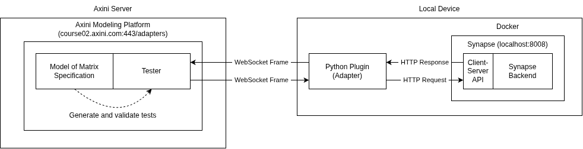
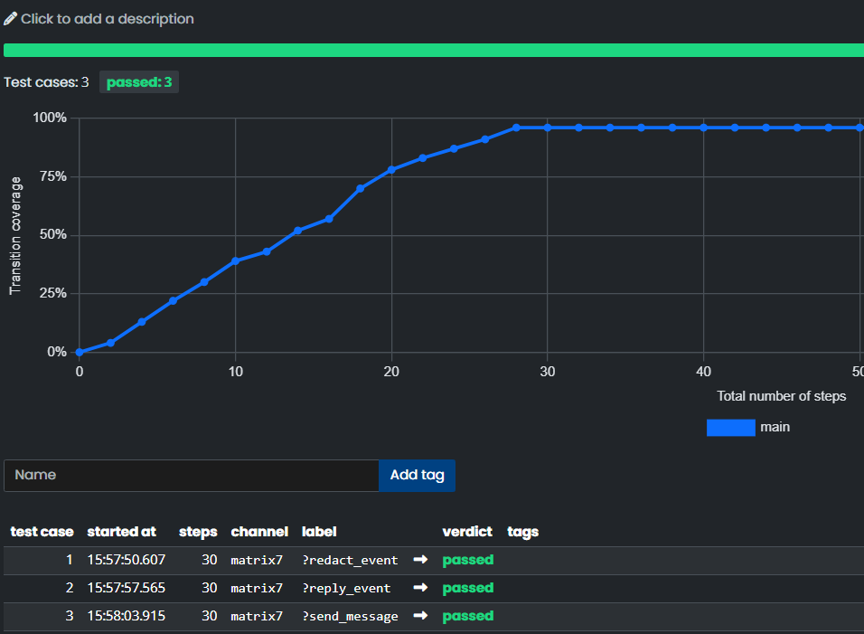

# Assignment 2
---
- Robin Brevink
- Bas Schram: s1077289
- Dirk van Roosmalen: s1176271
- Kars Visscher: s1170434
---

# Model-Based Testing: AMP and your SUT
## Exercise 2: Description of SUT and test scope

The discription of our SUT and the scope of the tests is similar to that of assignment 1.

Our system-under-test is [Synapse](https://github.com/element-hq/synapse) ([release v1.164.2](https://github.com/element-hq/synapse/releases/tag/v1.164.2)), a (home)server developed by [Element](https://element.io/). Synapse is an open source instance of [Matrix](https://matrix.org/) ([v1.19](https://spec.matrix.org/v1.19/)) written in Python. Using Synapse, the user can run a chat server and connect to it using a web client on [app.element.io](https://app.element.io/). These enable communication in accordance with the Matrix communication protocol. Therefore we will create a model of the relevant parts of the Matrix communication protocol and test whether Synapse complies with this protocol.

We will be testing the basic messaging functionalities of the SUT, namely creating a room and sending/deleting/editing/pinning/replying to/reacting to a message.

The interface utilized during testing is the Matrix client-server API. Relevant documentation can be found in the [Matrix specification](https://spec.matrix.org/v1.19/client-server-api/). Refer to the following chapters in particular:

| Feature             | Relevant Chapter                                                                         |
| ------------------- | ---------------------------------------------------------------------------------------- |
| Errors              | [Chapter 1.1](https://spec.matrix.org/v1.19/client-server-api/#standard-error-response)  |
| Logging in          | [Chapter 4.3](https://spec.matrix.org/v1.19/client-server-api/#login)                    |
| Sending room events | [Chapter 7.7](https://spec.matrix.org/v1.19/client-server-api/#sending-events-to-a-room) |
| Deleting an event   | [Chapter 7.9](https://spec.matrix.org/v1.19/client-server-api/#redactions)               |
| Creating a room     | [Chapter 8.2](https://spec.matrix.org/v1.19/client-server-api/#creation)                 |
| Leaving a room      | [Chapter 8.5.2](https://spec.matrix.org/v1.19/client-server-api/#leaving-rooms)          |
| Sending a message   | [Chapter 10.2](https://spec.matrix.org/v1.19/client-server-api/#instant-messaging)       |
| Pinning events      | [Chapter 10.2](https://spec.matrix.org/v1.19/client-server-api/#events-2)                |
| Replying to events  | [Chapter 10.3](https://spec.matrix.org/v1.19/client-server-api/#rich-replies)            |
| Replacing a message | [Chapter 10.39](https://spec.matrix.org/v1.19/client-server-api/#event-replacements)     |
| Reacting to events  | [Chapter 10.40](https://spec.matrix.org/v1.19/client-server-api/#event-annotations-and-reactions) |

## Exercise 3: Description of the Model
Compared to the testing domain of assignment 1, we have decided to drop tests expecting HTTP status codes 404 (Not Found) and 405 (Method Not Allowed), as they concern invalid HTTP endpoints, and the only way to conclude an endpoint does not exist would be to specify all Matrix endpoints that do exist.

Our model assumes we start in a state where the user is logged in and is authenticated, but no other actions have yet been executed. For practical reasons, it is also assumed that the user's requests are not subject to rate limiting. The only event that can take place in this state is room creation. Once a room has been created, we enter a loop where any of the following actions are allowed to take place:
- Sending a message
- Deleting a message
- Editing a message
- Pinning a message
- Replying to a message (with another message)
- Reacting to a message (with an emoji)

The loop follows a simple request-response format, so we will explain all possible transitions in a table following this format. For each possible action we have a corresponding stimulus in the Axini model. The possible responses are either a success or error response, which all have the same format. Below is the list of stimuli that are contained within our model, along with the parameters that are considered valid. 

| Action                | Stimulus       | Parameters                                                     |
| --------------------- | -------------- | -------------------------------------------------------------- |
| Creating a room       | ?create_room   | name : string                                                  |
| Leaving a room        | ?leave_room    | room_id : string user_id : string                           |
| Sending a message     | ?send_message  | message : string room_id : string                           |
| Deleting a message    | ?redact_event  | event_id : string room_id : string redaction_id : string |
| Editing a message     | ?replace_event | message : string room_id : string event_id : string      |
| Pinning a message     | ?pin_event     | room_id : string event_id_list : \[string]                  |
| Replying to a message | ?reply_event   | message : string room_id : string event_id : string      |
| Reacting to a message | ?react_message | message : string room_id : string event_id : string      |
Apart from stimuli, only two valid responses are modeled.

| Response name     | Response | Parameters                                                  |
| ----------------- | -------- | ----------------------------------------------------------- |
| Request succeeded | !succes  | code : integer id : string                               |
| Request failed    | !error   | code : integer error_msg : string error_text : string |

The SUT follows a simple request-response format. Therefore for each state we describe the accepted stimuli alongside the possible accepted responses. The generated visualization of our model is pictured below.

Starting from the initial state *roomless*, the user can create a room which can either fail or succeed. It it fails, the user is back in state *roomless*. If it succeeds, the user is sent to state *room*. From here, the user can execute any of the message-related actions, assuming they can supply the valid parameters. Actions like for example message deletion require a message to have been sent already. To achieve this, we keep track of a list of valid messages (`event_ids`), which is referenced in one of the constraints: `event_id in event_ids`.

There are also several events that are not eligible to be replaced by a message, of these id's is kept track in `nreplace_ids`. The array `transaction_ids` is used to guarantee that the transaction id's given are unique. The final array `reactions` is used to do the same for reactions, this is an under specification as by the matrix protocol you are allowed to send the same reaction to different events, but this would result in a significantly more complicated data structure and constraints. These variables were needed to make the model more general as with just states we could only have a specific finite amount of event id's at most which is not the case in the matrix protocol. 

Then we still have some simple variables: `current_room_id` which describes the current room id that is needed in most room events , `temp_id` which is used to temporarily remember some data from a receive that is needed in a send and `reg_user_id` which is used to get the user id for the out commented test case of successfully leaving a room. This should work in the case the `reg_user_id` matches the actual user id.

## Exercise 4: Adapter
The plugin adapter is situated between the remote AMP and our locally run SUT. It's primary purpose is to facilitate a connection between the two. 

A set of functionally identical plugin adapters was provided by [Axini](https://github.com/Axini) in 5 different programming languages. Because of our shared proficiency with Python, we picked the [Python Plugin Adapter](https://github.com/Axini/smartdoor-adapter-python). This PA contained the implementation for the Smartdoor assignment, which we modified to support communication with Synapse instead while keeping in mind [best practices](https://course02.axini.com/docs/tech/adapters/adapter_best_practices.html).

The `handler.py` translates AMP model labels into Matrix API calls, which is implemented by using a separate function for every type of stimulus in the model contract to translate it and its arguments into an object that is passed to `matrix_connection.py` to build valid HTTP request with those arguments as parameters. The SUT's response is translated in a similar way and in the opposite direction. In successful requests, this is done by extracting the HTTP status code `code=200` and room/event/state-event ID `id` and sending them back as arguments for a `!success` response. For unsuccessful requests, the HTTP status code `code`, meaning of this code `error_msg` and explanation of what went wrong `error_text` are sent back as arguments for a `!error` response.

The `matrix_connection.py` acts as a small authenticated HTTP client for Synapse's Matrix client-server API. It takes the objects generated by `handler.py` and translates them into actual HTTP requests, which are executed. The responses of which are parsed and send back to the `handler.py` for translation. Although the plugin adapter runs locally on the same device as the SUT, the URL of the Synapse homeserver and the access token for the authenticated user are part of the configuration, which can be entered in AMP in the *Adapter* tab. 

## Exercise 5: Test Architecture
The diagram below shows that the test architecture consists out of 3 main parts: the Axini Modeling Platform (AMP), the adapter, and the SUT. AMP is responsible for hosting the model (based on the specifications of Matrix) and generating / validating tests based on this model. These tests consist out of generating stimuli (asking the SUT to do something) and validating the received responses (the reaction of the SUT). All allowed stimuli and responses are defined in the model.

The adapter is responsible for converting stimuli from the model in AMP into valid HTTP requests before passing on these requests to the SUT. When the adapter receives a response back, it gets translated back into an AMP response, which is passed on to the testing platform. Our SUT (Synapse) runs locally in a Docker container. We communicate with it over HTTP through the Client-Server API. Once a request is processed, a HTTP response is sent back to the plugin adapter. AMP communicates with with the plugin adapter over the Secure WebSocket protocol, the exact workings of which are outside of the scope of this report.

## Exercise 6: MBT Testing
By running the final working model with three separate test cases and a depth of 30 each, we find that all lead to a passing result. This means that the examined section of Synapse behaves as expected given our model.

## Exercise 7: MBT Test Selection
When generating tests, the main variables to vary are the depth of test cases and the number of test cases. The first adaptation was going from depth 30 on 3 cases to depth 60 on 6 cases. When we did this we found a missing part in our model where we were not taking the `M_DUPLICATE_ANNOTATION` error into account.

Thanks to the more extensive test we found this error and could update the model. The second adaptation was going from depth 30 on 3 cases to depth 10 on 3 cases. This case was the largest case we could make without getting a 100% test coverage. The third adaptation was to revert to the default constraint solver instead of z3. This resulted in a multitude of failures because the default constraint solver cannot handle the constraints set in the model well, primarily around resolving strings and subset constraints on empty sets.

## Exercise 8: MBT Results
The primary result from the changes in exercise 7 is that the model was updated based on the results. By doing a more extensive test case, we could create an environment that differs from the default. This way we were able to test parts of the model we could not test earlier. For this we updated the model to not allow sending the same reaction twice, which is technically an under specification as one is allowed to do so given that they are sent as reaction to different events.

We also found that there are no errors when replacing events that one should not be able to replace with message events according to the specification. As far as we found, the specification does not mention the exact error message that is supposed to be returned in this case, if any at all. To solve this, we removed the lines in the model testing for this error. Apart from this, we did not find any other problems and all other test cases passed.

## Evaluation
### (9) Detected failures

### (10) Implementation relation
In both assignments, the interaction with the Synapse server remains mostly the same, namely by sending HTTP requests and receiving the responses. For the first assignment we needed to decide the test cases ourselves and then manually decide whether the response passed the test. In this assignment however, test generation and validation is handled by Axini, and the focus of the implementation was put more on creating a suitable model and adapter for the Axini platform. So in terms of the implementation for the actual testing, this is where the two approaces diverge quite heavily. However, for both approaches you still need the same knowledge on how the connection with Synapse and the API works, so this knowledge is still useful when using different testing methods.

### (11) Support for test input generation and output checking
One of the primary features of AMP is that it is able to automatically generate and test output based on the model you create. In contrast to the testing of assignment 1, this means you can put more focus on the structure of your SUT and which functionalities you want to test, rather than coming up with test cases. As mentioned before however, the test generation is not flawless (such as the case with strings) and you still have to manually confirm that everything you want tested is actually being tested, but overall it does enable you to more easily scale up the scope of your testing.

### (12) Test selection
In the first assignment, we had no real systematic method of coming up with concrete test cases. We took a section of the SUT that we wanted to test and looked at the specification for that functionality. We then simply wrote down what came up first, which gave us a list of a dozen or so both correctly and incorrectly send a message using the client-server API. This set was by no means exhaustive for the functionality we wanted to test, and we kept thinking of new distinct test cases.

Using AMP, we did not have to select any tests to begin with. We simply described the expected behavior of the system according to the specification and AMP took care of generating valid tests for us. Creating and tweaking the model however still took some effort, making it less feasible for smaller numbers of test cases.

### (13) Modelling notation
The AML notation is quite easy to use. You can make states and the like quite easily, but when you get to more complicated constraints it quickly becomes harder to read and you get some not obvious syntax. Examples of this are how you need to add all information into strings for updates and constraints, and the syntax of the language, for example the subset constraint. The last one you definitely can get used to.

### (14) Usability of AMP
AMP does have some annoying things to deal with, for example that the default constraint solver can not properly handle strings. Luckily there is a beta feature to use z3 which can handle such constraints. The same applies for the subset constraint to get subsets out of the empty list. And while there is some backtracking and version control supported, it is quite limited. However, the tools for visualization are quite nice. You can easily add more information through notes as needed, but unfortunately the visual graph representations can get messy quite quickly. This leads to them being not that useful, especially if every transition has a lot of constraints. Despite this, the explore tool was quite use full to find problems in the model, primarily because it can give the variables for a current state and its constraints. In short while it has some problems that can be quite annoying to deal with AMP is very usable.

### (15) Effort necessary for modelling
Setting up the adapter itself was relatively easy, as the provided Python plugin adapter already handled the communication with AMP. Testing it was more difficult, because a failed test did not immediately show whether the problem was in the model, the adapter, or Matrix as SUT. We had to compare the models expectations with the adapters requests and responses, and with Synapses actual behaviour, to find the cause. Changes to the models interface, such as stimulus names or parameters, also required corresponding changes in the adapter to keep them aligned. Overall, testing and debugging required more effort than setting up the adapter.
