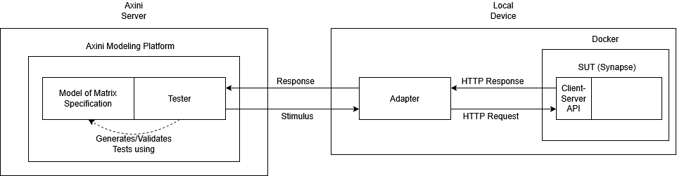
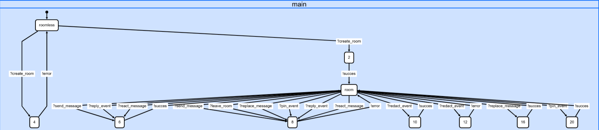
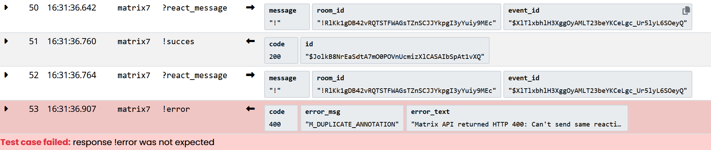
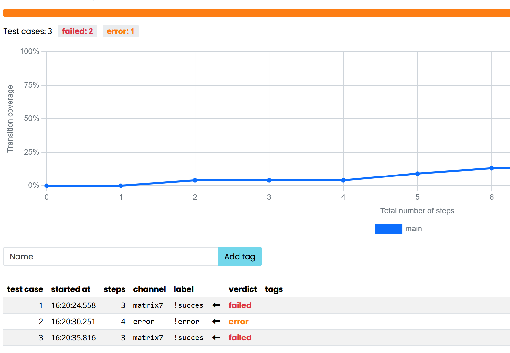

# Assignment 2
---
- Robin Brevink
- Bas Schram
- Dirk van Roosmalen: s1176271
- Kars Visscher: s1170434
---

# Model-Based Testing: AMP and your SUT
## Exercise 2: Description of SUT and test scope

The discription of our SUT and the scope of the tests is similar to that of assignment 1.

Our system-under-test is [Synapse](https://github.com/element-hq/synapse) ([release v1.164.2](https://github.com/element-hq/synapse/releases/tag/v1.164.2)), a (home)server developed by [Element](https://element.io/). Synapse is an open source instance of [Matrix](https://matrix.org/) ([v1.19](https://spec.matrix.org/v1.19/)) written in Python. Using Synapse, the user can run a chat server and connect to it using a web client on [app.element.io](https://app.element.io/). These enable communication in accordance with the Matrix communication protocol. Therefore we will create a model of the relevant parts of the Matrix communication protocol and test whether Synapse complies with this protocol.

We will be testing the basic messaging functionalities of the SUT, namely creating a room and sending/deleting/editing/pinning/replying to/reacting to a message.

The interface utilized during testing is the Matrix client-server API. Relevant documentation can be found in the [Matrix specification](https://spec.matrix.org/v1.19/client-server-api/). Refer to the following chapters in particular:

| Feature             | Relevant Chapter                                                                         |
| ------------------- | ---------------------------------------------------------------------------------------- |
| Errors              | [Chapter 1.1](https://spec.matrix.org/v1.19/client-server-api/#standard-error-response)  |
| Logging in          | [Chapter 4.3](https://spec.matrix.org/v1.19/client-server-api/#login)                    |
| Sending room events | [Chapter 7.7](https://spec.matrix.org/v1.19/client-server-api/#sending-events-to-a-room) |
| Deleting an event   | [Chapter 7.9](https://spec.matrix.org/v1.19/client-server-api/#redactions)       |
| Creating a room     | [Chapter 8.2](https://spec.matrix.org/v1.19/client-server-api/#creation)                 |
| Sending a message   | [Chapter 10.2](https://spec.matrix.org/v1.19/client-server-api/#instant-messaging)       |

## Exercise 3: Description of the Model
Compared to the testing domain of assignment 1, we have decided to drop tests expecting HTTP status codes 404 (Not Found) and 405 (Method Not Allowed), as they concern invalid HTTP endpoints, and the only way to conclude an endpoint does not exist would be to specify all Matrix endpoints that do exist.

Our model assumes we start in a state where the user is logged in and is authenticated, but no other actions have yet been executed. For practical reasons, it is also assumed that the user's requests are not subject to rate limiting. The only event that can take place in this state is room creation. Once a room has been created, we enter a loop where any of the following actions are allowed to take place:
- Sending a message
- Deleting a message
- Editing a message
- Pinning a message
- Replying to a message (with another message)
- Reacting to a message (with an emoji)

The loop follows a simple request-response format, so we will explain all possible transitions in a table following this format. For each possible action we have a corresponding stimulus in the Axini model. The possible responses are either a success or error response, which all have the same format. Below is the list of stimuli that are contained within our model, along with the parameters that are considered valid. 

| Action                | Stimulus       | Parameters                                                     |
| --------------------- | -------------- | -------------------------------------------------------------- |
| Creating a room       | ?create_room   | name : string                                                  |
| Leaving a room        | ?leave_room    | room_id : string user_id : string                           |
| Sending a message     | ?send_message  | message : string room_id : string                           |
| Deleting a message    | ?redact_event  | event_id : string room_id : string redaction_id : string |
| Editing a message     | ?replace_event | message : string room_id : string event_id : string      |
| Pinning a message     | ?pin_event     | room_id : string event_id_list : \[string]                  |
| Replying to a message | ?reply_event   | message : string room_id : string event_id : string      |
| Reacting to a message | ?react_message | message : string room_id : string event_id : string      |
Apart from stimuli, only two valid responses are modeled.

| Response name     | Response | Parameters                                                  |
| ----------------- | -------- | ----------------------------------------------------------- |
| Request succeeded | !succes  | code : integer id : string                               |
| Request failed    | !error   | code : integer error_msg : string error_text : string |

The SUT follows a simple request-response format. Therefore for each state we describe the accepted stimuli alongside the possible accepted responses.

Starting from the initial state *roomless*, the user can create a room which can either fail or succeed. It it fails, the user is back in state *roomless*. If it succeeds, the user is sent to state *room*. From here, the user can execute any of the message-related actions, assuming they can supply the valid parameters. Actions like for example message deletion require a message to have been sent already. To achieve this, we keep track of a list of valid messages (`event_ids`), which is referenced in one of the constraints: `event_id in event_ids`.

## Exercise 4: Adapter
The plugin adapter is situated between the remote AMP and our locally run SUT. It's primary purpose is to facilitate a connection between the two. 

A set of functionally identical plugin adapters was provided by [Axini](https://github.com/Axini) in 5 different programming languages. Because of our shared proficiency with Python, we picked the [Python Plugin Adapter](https://github.com/Axini/smartdoor-adapter-python). This PA contained the implementation for the Smartdoor assignment, which we modified to support communication with Synapse instead while keeping in mind [best practices](https://course02.axini.com/docs/tech/adapters/adapter_best_practices.html).

The `handler.py` translates AMP model labels into Matrix API calls, which is implemented by using a separate function for every type of stimulus in the model contract to translate it and its arguments into an object that is passed to `matrix_connection.py` to build valid HTTP request with those arguments as parameters. The SUT's response is translated in a similar way and in the opposite direction. In successful requests, this is done by extracting the HTTP status code `code=200` and room/event/state-event ID `id` and sending them back as arguments for a `!success` response. For unsuccessful requests, the HTTP status code `code`, meaning of this code `error_msg` and explanation of what went wrong `error_text` are sent back as arguments for a `!error` response.

The `matrix_connection.py` acts as a small authenticated HTTP client for Synapse's Matrix client-server API. It takes the objects generated by `handler.py` and translates them into actual HTTP requests, which are executed. The responses of which are parsed and send back to the `handler.py` for translation. Although the plugin adapter runs locally on the same device as the SUT, the URL of the Synapse homeserver and the access token for the authenticated user are part of the configuration, which can be entered in AMP in the *Adapter* tab. 

## Exercise 5: Test Architecture

The diagram shows that the test architecture consists out of 3 main parts: the Axini Modeling Platform (AMP), the adapter, and the SUT. AMP is responsible for hosting the model (based on the specifications of Matrix) and generating / validating tests based on this model. These tests consist out of generating stimuli (asking the SUT to do something) and validating the received responses (the reaction of the SUT). All allowed stimuli and responses are defined in the model.

The adapter is responsible for converting the stimuli into requests the SUT can actually understand and passing them on. When the adapter receives a response back, it needs to translate this back into the language AMP understands and pass it back to the testing platform.

Our SUT (Synapse) runs locally in a Docker container. It receives HTTP requests from the adapter and handles them through the Client-Server API. Once it has finished processing the request, it sends an HTTP response stating whether the request was a succes or whether there was an error during processing/handling.

## Exercise 6: MBT Testing
The final working model with three separate cases with a depth of 30 each leads to a passing result. Thus Matrix behaves as expected given our model.

## Exercise 7: MBT Test Selection

The main variables to vary are the depth of test cases and the number of test cases.
The first adaptation was going from depth 30 on 3 cases to depth 60 on 6 cases.
When we did this we found a missing part in our model where we were not taking the M_DUPLICATE_ANNOTATION into account.

Thanks to the more extensive test we found this and could update the model.
The second adaptation was going from depth 30 on 3 cases to depth 10 on 3 cases.
This case was the largest case we could make without getting a 100% test coverage.
The third adaptation was to revert to the default constraint solver instead of z3.
This resulted in a multitude of failures because the default constraint solver cannot handle the constraints set in the model well. Primarily around resolving strings and subset constraints on empty sets.

## Exercise 8: MBT Results

The most primary result from the changes in exercise 7 is that the model was updated based on the results.
By doing a more extensive testcase we could create an environment that differs from the default.
This way we were able to test parts of the model we could not test earlier. For this we updated the model to not allow sending the same reaction twice. Which is technically an under specification as you are allowed to do so if the are send as reaction to different events.

We also discovered that there are no errors when replacing events that you should not be able to replace with message events according to specification. There it does not mention which error message you are supposed to receive or if any at all for this so far as we found. To take care of this problem  we removed the lines testing for this from the model. As such all we did not find any other problems, and all other test cases passed.

